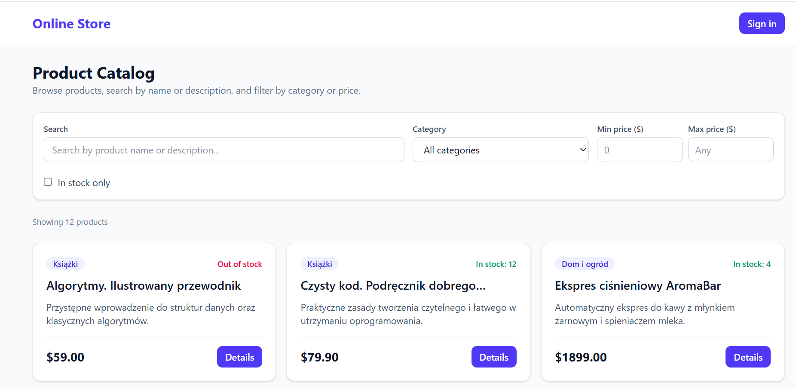
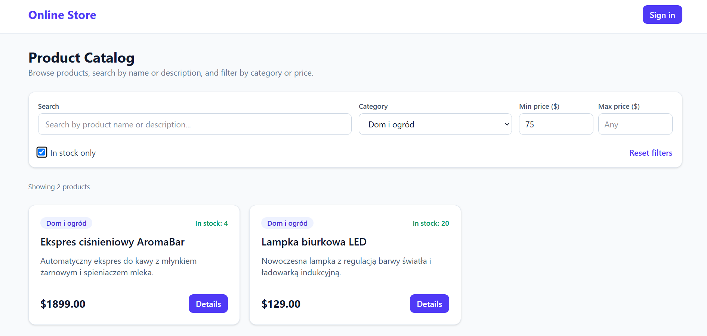
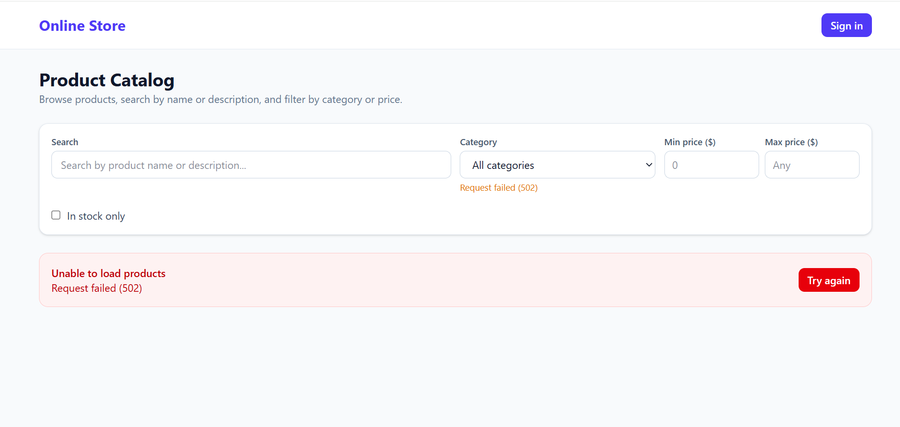
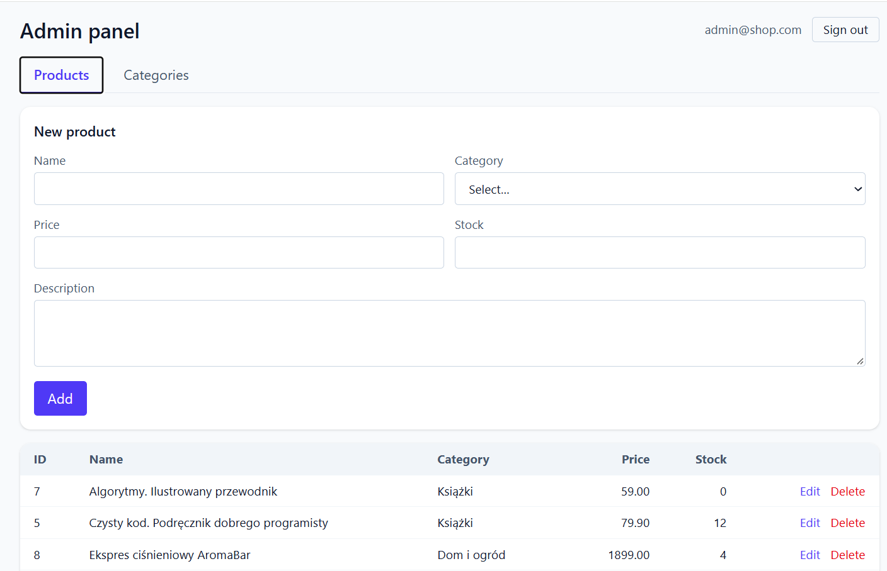

# Online Store Management Web Application
> **E-Commerce Web Application / Platforma do zarządzania sklepem internetowym**

[](https://dotnet.microsoft.com/)
[](https://react.dev/)
[](https://tailwindcss.com/)
[](https://www.postgresql.org/)
[](https://www.docker.com/)

---

## 📌 Project Overview

This project is an e-commerce web application designed and developed as part of the academic curriculum for the **"Projekt zespołowy" (Team Project)** laboratory course.

* **Institution:** Częstochowa University of Technology (*Politechnika Częstochowska*)
* **Faculty:** Faculty of Computer Science and Artificial Intelligence (*Wydział Informatyki i Sztucznej Inteligencji*)
* **Department:** Department of Computer Science (*Katedra Informatyki*)
* **Academic Year:** 2026 / 2027
* **Group:** 2 | **Team:** `IO_2`
* **Topic:** Design and implementation of a web application for online store management (*Projektowanie i implementacja aplikacji webowej do zarządzania sklepem*).

The primary goal of the system is to provide a complete, containerized, client-server web solution for online shopping, product browsing, cart management, and administrative order/catalog processing.

---

## 👥 Team Members & Responsibilities

| Member | Role | Core Responsibility |
|---|---|---|
| **Yahor Hurski** | Project Lead (*Kierownik projektu*) | Authentication, authorization, JWT tokens, and user management (`User`, `Role`). |
| **Nazar Koretskyi** | Team Developer | Product catalog and administrative management (`Product`, `Category`, CRUD operations). |
| **Stepan Tarasevych** | Team Developer | Cart, checkout, and order fulfillment (`Cart`, `CartItem`, `Order`, `OrderItem`). |

---

## 🚀 Tech Stack

### Frontend
* **Framework:** [React 19](https://react.dev/)
* **Build Tool:** [Vite](https://vite.dev/)
* **Styling:** [Tailwind CSS v4](https://tailwindcss.com/)
* **Linter:** [Oxlint](https://oxc.rs/)

### Backend
* **Runtime & Framework:** [.NET 10 (ASP.NET Core Web API)](https://dotnet.microsoft.com/)
* **Language:** C# 13
* **ORM:** [Entity Framework Core 10](https://learn.microsoft.com/en-us/ef/core/)
* **Database Provider:** [Npgsql Entity Framework Core PostgreSQL Provider](https://www.npgsql.org/efcore/)
* **Object Mapping:** [AutoMapper](https://automapper.io/)
* **API Documentation:** OpenAPI (Scalar / Swagger)

### Database & DevOps
* **Database:** PostgreSQL 16 (Alpine)
* **Database GUI:** pgAdmin 4
* **Containerization:** Docker & Docker Compose
* **Version Control:** Git & GitHub

---

## 🎨 UI / UX Philosophy

The user interface is built with modern usability standards in mind:
* **Responsive Design:** Mobile-first, fully responsive layouts powered by Tailwind CSS v4, supporting mobile, tablet, and desktop viewports.
* **Intuitive Navigation:** Quick access to the product catalog, category filters, interactive search bar, shopping cart summary, and user profile.
* **User Feedback:** Clear loading indicators, accessible toast notifications for cart actions (add, remove, quantity update), and user-friendly error messages.
* **Separation of Concerns:** Distinct views and controls for standard customers vs. administrators:
  * **Customer View:** Fast catalog browsing, filters, product details, seamless cart manipulation, and single-click order placement.
  * **Admin Panel:** Product/category CRUD forms, stock management, and order status update interfaces.

---

## 🖼️ Screenshots

### Product Catalog


### Search & API Filtering


### Error Handling & Retry State


### Admin Panel


---

## 🔒 Security & Data Integrity

* **Password Security:** Passwords are never stored in plain text; secure password hashing algorithms (e.g., PBKDF2 / BCrypt / Argon2) are enforced.
* **Authentication:** Stateless authentication using cryptographically signed **JSON Web Tokens (JWT)** passed via HTTP `Authorization: Bearer <token>` headers.
* **Role-Based Access Control (RBAC):** Explicit separation of permissions between `User` and `Admin` roles. Administrative endpoints (product/category modifications, order status overrides) are inaccessible to unauthorized users.
* **Input Validation:** Strict server-side validation on all incoming DTO requests to prevent injection, tampering, and invalid model states.
* **Database Integrity:** Foreign key relationships, unique constraints (e.g., unique customer email index), and decimal currency precision enforced at the PostgreSQL database level.

---

## 📋 Functional Requirements

### Must-Have Requirements
1. **Authentication & Authorization:** User registration, login, JWT token issuance and validation, protected routes according to roles (`User` / `Admin`).
2. **Product Catalog & Management:** Public catalog browsing and search; administrative CRUD operations for products and categories.
3. **Cart & Order Processing:** Adding/removing items from cart, quantity adjustment, real-time total price calculation, placing orders, order history for users, and status tracking (`Pending`, `Processing`, `Completed`, `Cancelled`).

### Nice-to-Have Requirements (Extensions)
* **Wishlist:** Favorite products saved per authenticated user.
* **Reviews & Ratings:** Customer product ratings and feedback with average rating calculations.
* **Advanced Catalog Tools:** Multi-criteria filtering, sorting (price, date, name), and server-side pagination.

---

## 📁 Project Structure

```
Group-Project/
├── docker-compose.yml              # Container orchestration
├── Backend.Tests/                  # xUnit tests for the API
├── docs/                           # Project documentation
│   ├── Doxyfile                    # Doxygen configuration (backend API docs)
│   ├── project-card.pdf            # Project Charter
│   ├── diagrams/
│   │   └── orm-diagram.png         # Database ER diagram
│   └── images/                     # UI screenshots for README
│
├── Backend/                        # Backend REST API
│   ├── Backend.csproj              # Project configuration
│   ├── Dockerfile                  # Backend container image
│   ├── Properties/                 # Launch settings
│   ├── DAL/                        # Data Access Layer
│   ├── Model/                      # Domain Entities
│   ├── Services/                   # Business Logic Layer
│   │   ├── DTOs/                   # Data Transfer Objects
│   │   ├── Mapping/                # Mapping profiles
│   │   └── Common/                 # Shared utilities and constants
│   └── Web/                        # API host and presentation layer
│       ├── Controllers/            # API Controllers
│       ├── appsettings.json        # Application configuration
│       ├── appsettings.Development.json
│       ├── Backend.http            # HTTP test requests
│       └── Program.cs              # Application entry point
│
└── Frontend/                       # Frontend application
    ├── Dockerfile                  # Frontend container image (Nginx)
    ├── nginx.conf                  # Nginx SPA + /api reverse proxy config
    ├── index.html                  # HTML entry point
    ├── vite.config.js              # Bundler configuration
    ├── package.json                # Dependencies and scripts
    └── src/
        ├── assets/                 # Static assets
        ├── components/             # Reusable UI components
        ├── pages/                  # Page components
        ├── services/               # API service layer
        ├── context/                # State context providers
        ├── hooks/                  # Custom hooks
        ├── utils/                  # Helper utilities
        ├── App.jsx                 # Root component
        ├── main.jsx                # Application root
        └── index.css               # Global stylesheet
```

---

## ⚙️ Getting Started

### Prerequisites

Ensure the following tools are installed on your workstation:
* [Docker Desktop](https://www.docker.com/products/docker-desktop/) (or Docker Engine + Docker Compose)
* [.NET 10 SDK](https://dotnet.microsoft.com/download/dotnet/10.0)
* [Node.js](https://nodejs.org/) (version 20 LTS or higher recommended)
* [Git](https://git-scm.com/)

---

### Step 1: Clone the Repository
```bash
git clone https://github.com/<your-organization>/Group-Project.git
cd Group-Project
```

---

### Option A: Full Stack with Docker Compose (3 containers)
Run the database, backend API, and frontend together in the project root:
```bash
docker compose up -d --build
```
* **Frontend:** `http://localhost:5173`
* **Backend API:** `http://localhost:5007` (OpenAPI in `Development`)
* **PostgreSQL:** `localhost:5432` (Database: `shop_db`, User: `postgres`, Password: `postgres`)
* *(Optional)* Start **pgAdmin 4** (`http://localhost:5050`, `admin@shop.com` / `admin`) with:
  ```bash
  docker compose --profile tools up -d
  ```

---

### Option B: Run Locally (Database in Docker)
1. Start only PostgreSQL:
   ```bash
   docker compose up -d db
   ```

### Step 3: Run the Backend API
1. Navigate to the `Backend` directory:
   ```bash
   cd Backend
   ```
2. Restore dependencies and run the server:
   ```bash
   dotnet restore
   dotnet run
   ```
3. The API will start locally (typically at `https://localhost:7xxx` or `http://localhost:5xxx`). OpenAPI documentation is accessible in development mode.

---

### Step 4: Run the Frontend
1. Open a new terminal and navigate to `Frontend`:
   ```bash
   cd Frontend
   ```
2. Install dependencies:
   ```bash
   npm install
   ```
3. Start the Vite development server:
   ```bash
   npm run dev
   ```
4. Open your browser and navigate to `http://localhost:5173`.

---

## 🧪 Testing

| Suite | Command | What it covers |
|---|---|---|
| Backend (xUnit) | `dotnet test Backend.Tests` | `GET /api/products` query binding and validation (always runs, no database needed) and `ProductService` filtering against PostgreSQL |
| Frontend (Vitest) | `cd Frontend && npm test` | Catalog page states (loading / error / empty), API filtering, URL-synced filters, API client |

The `ProductService` tests need a real PostgreSQL server because search uses `ILIKE`. Start the database first (`docker compose up -d db`); each run creates and drops its own throw-away database. Use the `TEST_DB_CONNECTION` environment variable to point to another server. When no server is reachable these tests are reported as **skipped**, not failed.

---

## 📚 Technical Documentation (Doxygen)

The backend API reference is generated with [Doxygen](https://www.doxygen.nl/) from the C# XML documentation comments (`/// <summary>`).

```bash
# from the repository root
doxygen docs/Doxyfile
```

Open `docs/doxygen/html/index.html`. The output folder is git-ignored and warnings are written to `docs/doxygen/warnings.log`. Doxygen can only parse the C# backend; the React frontend is not included.

---

## 🗄️ Database Management & Migrations

When models or database structures change, use Entity Framework Core CLI tools inside the `Backend` directory:

```bash
# Add a new migration
dotnet ef migrations add <MigrationName>

# Apply migrations to the PostgreSQL database
dotnet ef database update
```

---

## 📜 License & Acknowledgments
Developed for academic purposes at **Politechnika Częstochowska (Wydział Informatyki i Sztucznej Inteligencji)**. All rights reserved by team `IO_2`.
